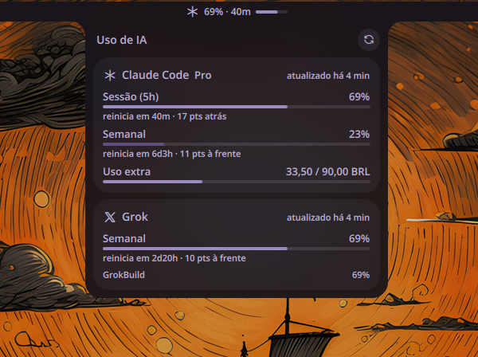

# AI Bar

AI Bar shows Claude Code and Grok (SuperGrok / Grok Build) plan usage in the
Noctalia bar and in a panel: percent, reset countdown and a progress bar.



## Plugin

| | |
|---|---|
| Id | `nandomoreirame/aibar` |
| Bar widget | `nandomoreirame/aibar:bar` |
| Panel | `nandomoreirame/aibar:panel` |
| Usage service | `nandomoreirame/aibar:usage` |

## Usage

Symlink this repo into the v5 plugin directory and enable it:

```bash
ln -s ~/dev/projects/noctalia-aibar ~/.local/share/noctalia/plugins/aibar
noctalia msg plugins enable nandomoreirame/aibar
```

Add `nandomoreirame/aibar:bar` to a bar. Left click opens the panel. Middle click
cycles the source (Claude accounts, then Grok) and the choice is saved.

```bash
noctalia msg panel-toggle nandomoreirame/aibar:panel
```

## Requirements

- Noctalia 5.x with plugin API 22 or newer
- `claude` CLI, logged in (`~/.claude/.credentials.json` present)
- `grok login` already done (`~/.grok/auth.json` present)
- Optional: `jq`, for `scripts/claude-swap`

The plugin only reads the credential files. It never writes them, copies them,
or refreshes a token.

## Settings

| Setting | Default | What it does |
|---------|---------|--------------|
| Provider in the bar | `claude` | Source the bar shows: `claude`, `grok`, or `claude:<name>`. Middle click cycles the sources. Changing this setting overrides that choice. |
| Refresh every (minutes) | `5` | Poll interval. Minimum 2, maximum 60. |
| Notify at (%) | `97` | One toast when a window crosses this percent upward. `0` turns notifications off. |
| Claude User-Agent | `claude-cli/2.1.281 (external, cli)` | Advanced. Must look like a published Claude Code CLI, or the usage endpoint answers 429. |
| Frozen Claude accounts | empty | One `Name=dir` per entry. The panel shows their last status. Example: `Frozen=~/.claude-freeze`. |

## IPC

```bash
noctalia msg plugin nandomoreirame/aibar:usage all refresh
noctalia msg plugin nandomoreirame/aibar:usage all cycle
```

## Notes

**Network.** `GET https://api.anthropic.com/api/oauth/usage` and
`GET https://cli-chat-proxy.grok.com/v1/billing?format=credits`, every
`poll_minutes`, on refresh, and when a credential file changes. Native HTTP
client. Tokens travel only in request headers.

**Files read**, never written: `~/.claude/.credentials.json`, `~/.claude.json`,
`<dir>/.credentials.json` and `<dir>/.claude.json` for each frozen account, and
`~/.grok/auth.json`.

**Files written**, in the plugin data directory: `snapshots.json` (usage data,
no credential) and `selection.json` (the bar source).

**Processes.** None. `scripts/claude-swap` is a separate CLI. The plugin never
runs it.

**Frozen accounts.** `scripts/claude-swap` swaps the active Claude Code login
(`~/.claude`) with the frozen one (`~/.claude-freeze`). Only the login moves:
`.credentials.json` and the `oauthAccount` block of `.claude.json`. Settings,
skills, memory, MCP servers and projects stay put. List any extra login in
Frozen Claude accounts so the panel can show its last status on its own tab.
After a swap, the card follows the account that is now active.

**v4.** The QML version lives on branch `legacy-v4` (v0.1.3) for noctalia-shell 4.7.x.

## Development

`./run-tests` needs the `luau` CLI. `lib/*.luau` is pure logic. The entries
(`service.luau`, `widget.luau`, `panel.luau`) and `plugin.toml` sit at the repo
root.

```bash
./run-tests
noctalia plugins lint .
```

## Credits

The endpoint contracts were learned from
[akitaonrails/ai-usagebar](https://github.com/akitaonrails/ai-usagebar) (MIT).
No code was reused.
